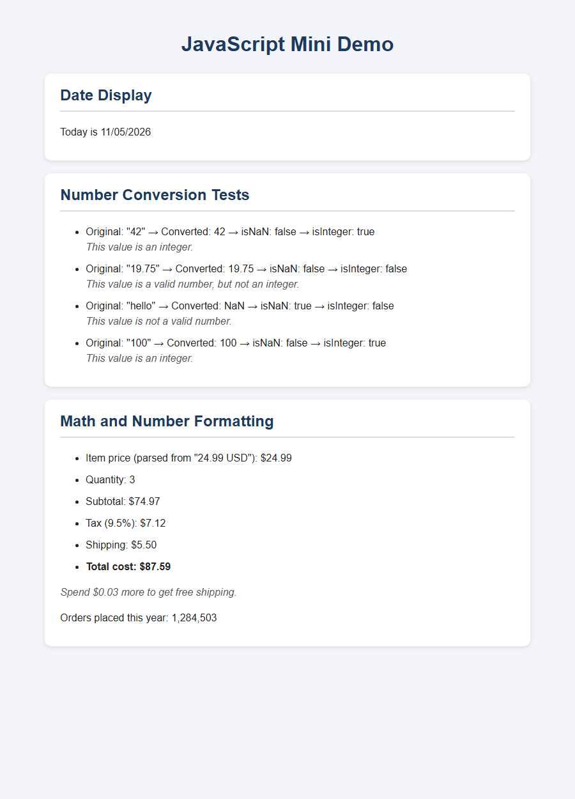

# Homework 9: JavaScript Built-In Objects

COMP 484 — JavaScript Mini Demo

## Live Site (GitHub Pages)

https://kiran-ragavender.github.io/comp484-hw9/

## Screenshot

Path: `screenshot.png`

## Built-In Objects and Methods Used

**Date object**
- `new Date()`
- `getMonth()`
- `getDate()`
- `getFullYear()`

**Number object**
- `Number()`
- `Number.isNaN()`
- `Number.isInteger()`
- `Number.parseFloat()`
- `toFixed()`
- `toLocaleString()`

**Other**
- `String()`
- `document.getElementById()`
- `textContent` / `innerHTML`

## Features

1. **Date Display** shows the current date as `Today is MM/DD/YYYY`, using `if/else` to add leading zeros.
2. **Number Conversion Tests** converts four strings (`"42"`, `"19.75"`, `"hello"`, `"100"`) with `Number()` and checks each one with `Number.isNaN()` and `Number.isInteger()`.
3. **Math and Number Formatting** is a price calculator (subtotal, tax, shipping, total) that uses `Number.parseFloat()`, `toFixed(2)`, and `toLocaleString()`. An `if/else` decides whether shipping is free.
4. **Extra credit** uses CSS styling to show each section as a separate card.

## Reflection

The easiest part was the math section, because adding and multiplying numbers and formatting them with `toFixed(2)` was straightforward. The hardest part was the number conversion section, since I could not use arrays or loops and had to keep many separate variables organized and named clearly. From the `Date` object, I learned that `getMonth()` starts counting at 0, so I had to add 1, and that single-digit months and days need a leading zero to match the `MM/DD/YYYY` format. From the `Number` object, I learned that `Number()` returns `NaN` for text like `"hello"`, that `Number.isNaN()` is a reliable way to check for that, and that `Number.parseFloat()` can read a number from the start of a string like `"24.99 USD"`. Finally, I learned that results can be shown directly in the browser by selecting elements with `document.getElementById()` and updating their `textContent` or `innerHTML`, instead of only logging them to the console.

## Sources

- MDN Web Docs: [Date](https://developer.mozilla.org/en-US/docs/Web/JavaScript/Reference/Global_Objects/Date), [Number](https://developer.mozilla.org/en-US/docs/Web/JavaScript/Reference/Global_Objects/Number)
